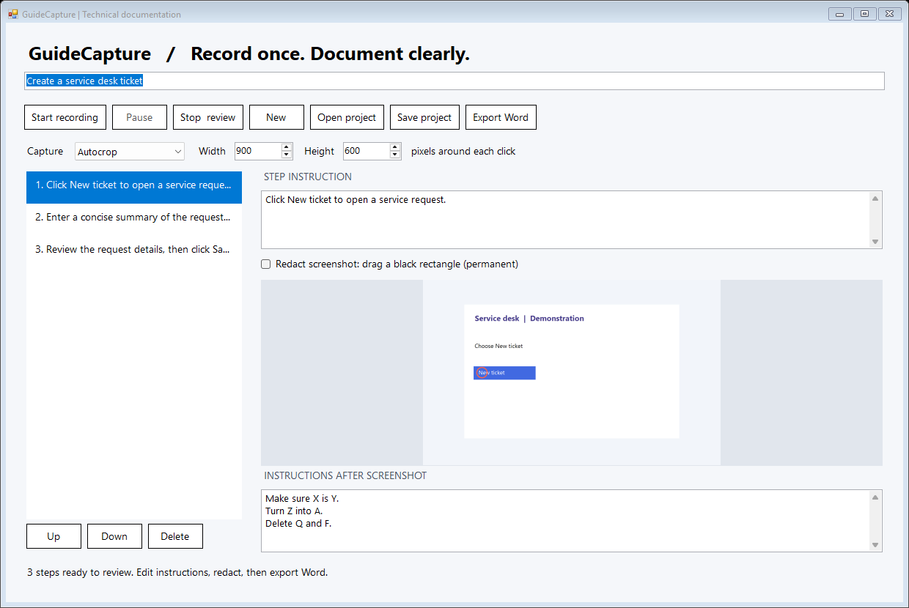
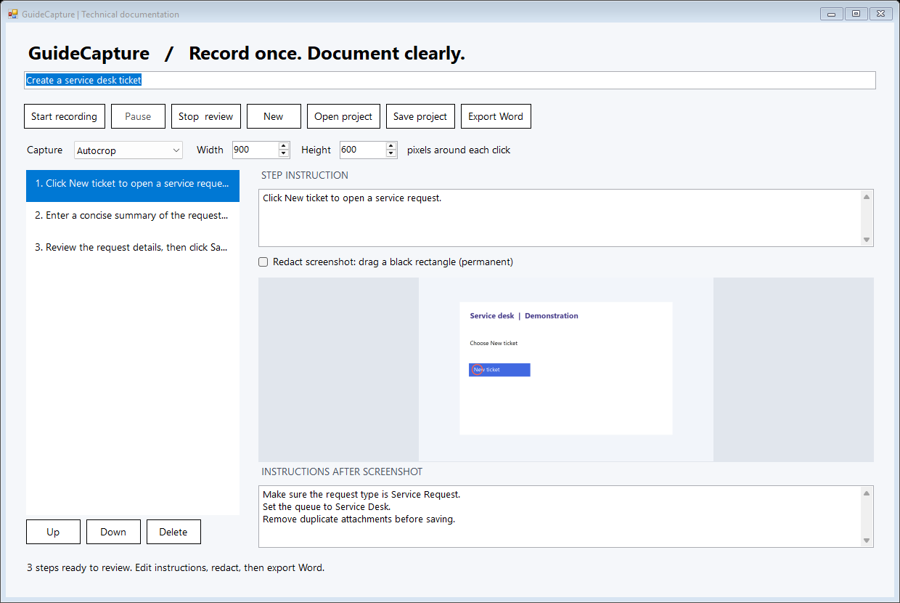
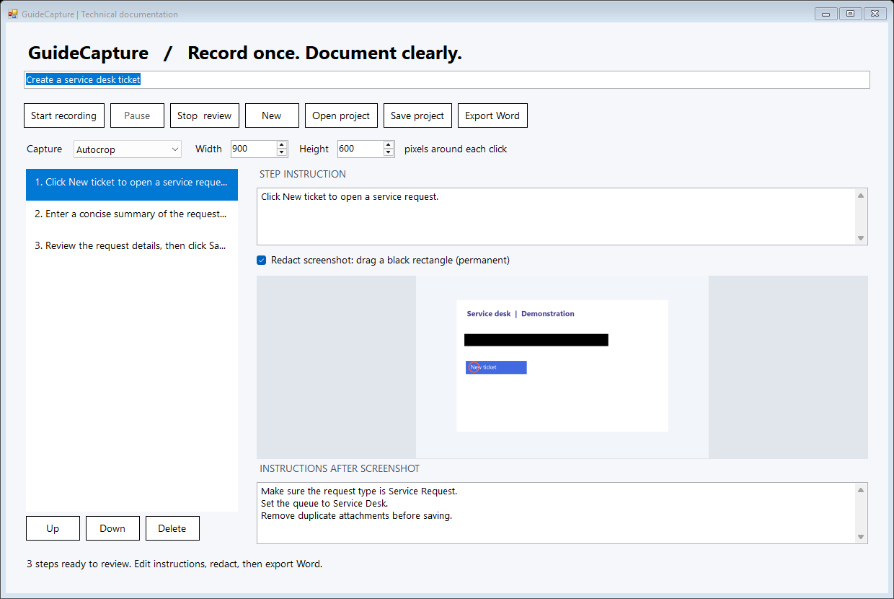

# GuideCapture

Create technical SOPs and step-by-step guides while you work. GuideCapture records clicks in Windows desktop apps and browsers, captures the surrounding screen area, and lets you edit the resulting guide before exporting it to Word for SharePoint.

Capture and editing run locally. No account, API key, cloud processing, or internet connection is required to use the app.

**Prototype:** this is an unsigned Windows application. Review the [limitations](#limitations) before a team rollout.

## Download and start

- **[Download the standalone EXE](https://github.com/Saturate2847/GuideCapture/raw/refs/heads/main/GuideCapture.exe)** if you only need the app.
- **[Download the full package](https://github.com/Saturate2847/GuideCapture/raw/refs/heads/main/GuideCapture-prototype.zip)** for the app, source, build script, example guide, and this illustrated manual.

Private repository downloads require GitHub access. Download the file itself using these links or GitHub's **Download raw file** button; do not save the GitHub HTML page.

1. Use a Windows PC with .NET Framework 4.8 installed.
2. If you downloaded the ZIP, extract it first.
3. Run `GuideCapture.exe`. No installer is needed. If your organization's security tools block it, use your normal approval process.
4. To try the editor without recording, select **Open project** and open `Example.guide` from the full package.

The screenshots below show the real application with fictional demonstration content. They illustrate the editor; they are not a recording of a customer environment.



## Create your first guide

### 1. Name the procedure and choose the capture area

Enter a descriptive title in the field below the GuideCapture heading, such as **Create a service desk ticket**.

The **Capture** dropdown defaults to **Autocrop**, which captures a **900 by 600 pixel** rectangle around each click. Change **Width** and **Height** if you need more or less context. Near a screen edge, the rectangle shifts inward; if the monitor is smaller than the requested area, the capture shrinks to fit.

Choose **Full monitor** when the reader needs to see the entire screen. These settings affect future screenshots, including manual captures; they do not resize existing steps. Settings last for the current app session.

### 2. Start recording

Select **Start recording**. GuideCapture minimizes so you can work in the target app.

Perform the procedure normally. Each left or right click creates a screenshot with a red click marker and a draft instruction. When available, the draft uses the clicked control's accessibility name and the window title. Always review the wording afterward.

The app captures immediately after a click. A menu that closes quickly may disappear before the screenshot is taken.

### 3. Pause or capture an extra step

Use these shortcuts while recording:

| Shortcut | Action |
| --- | --- |
| **Ctrl+Shift+F8** | Pause or resume recording |
| **Ctrl+Shift+F9** | Add a screenshot around the current mouse position |
| **Ctrl+Shift+F10** | Stop and return to the editor |

Typing, scrolling, and dragging do not automatically create steps. For example, after filling in a form, place the pointer over the relevant area and press **Ctrl+Shift+F9**, then write the explanation in the editor.

If shortcuts conflict with another app, restore GuideCapture from the taskbar to use its controls. You can also right-click its notification-area icon to pause/resume or stop and review. Pause before navigating through content that should not be captured.

### 4. Stop and review the steps

Press **Ctrl+Shift+F10**, or restore the app and select **Stop & review**.

Select a numbered step in the left-hand list. Its screenshot and instruction appear on the right. Use **Up**, **Down**, or **Delete** to organize the procedure. Selecting **Start recording** again appends captures to the same guide; select **New** to start a separate procedure.

### 5. Write instructions before and after each screenshot

Use the two text fields for different parts of the explanation:

- **Step instruction**, above the preview: the action the reader should take, such as "Click New ticket to open a service request."
- **Instructions after screenshot**, below the preview: additional directions, checks, or context. Press Enter to put each instruction on a separate line.

For example, the follow-up instructions could be:

```text
Make sure the request type is Service Request.
Set the queue to Service Desk.
Remove duplicate attachments before saving.
```



In Word, each step appears in this order: **step heading → initial instruction → screenshot → follow-up instructions → next step**. The follow-up field is optional. Its content stays with the step when you reorder or save it.

### 6. Redact sensitive information

Select the step, enable **Redact screenshot**, and drag a rectangle over the area to hide. The app paints solid black pixels into the image. Repeat for any additional areas, then turn off the checkbox when finished.



Redaction is permanent in the current project and has no undo. It applies to subsequent project saves and Word exports; it does not change earlier copies. Sensitive information in either text field must be edited separately. Review both the image and text before sharing.

### 7. Save an editable project

Select **Save project** to save a `.guide` file. This preserves screenshots, step order, initial instructions, and follow-up instructions so you can reopen and edit the procedure later.

Save before closing the app. **Export Word does not save the editable project**, and the prototype does not autosave.

### 8. Export Word and share

Select **Export Word**, choose a filename and location, then open the resulting `.docx` in Word to review it.

Steps flow continuously without forced page breaks between them. Screenshots keep their proportions and fit within **4.8 inches wide by 2.4 inches high**. Page breaks depend on screenshot proportions and the amount of text; a fixed number of steps per page is not guaranteed. Instructions remain editable in Word.

Upload the reviewed Word document to the appropriate SharePoint library using your usual process. GuideCapture does not upload automatically or manage SharePoint permissions.

## Which files do I need?

| File | Purpose |
| --- | --- |
| `GuideCapture.exe` | The standalone application; this is all you need to run it. |
| `Example.guide` | A fictional demonstration project for trying the editor. |
| Your saved `.guide` files | Editable projects containing screenshots and instructions. |
| Your exported `.docx` files | Word guides for review and distribution. |
| `GuideCapture.cs` | C# source code for inspection or modification. |
| `build.ps1` | Rebuilds the executable from the source. |
| `docs/images/` | Screenshots used in this manual; not required to run the app. |

The current app reads older version 1 projects and saves version 2 projects to preserve follow-up instructions. The old app cannot open version 2 projects. Re-export existing guides with the current app to get the compact Word layout.

## Troubleshooting

| Problem | What to check |
| --- | --- |
| The EXE will not start | Confirm Windows and .NET Framework 4.8 are available. The app is unsigned; check your organization's application approval process. |
| Shortcuts do not work | Another app may own the shortcut. Restore GuideCapture or use its notification-area menu. |
| A click is missing | Confirm recording is active and not paused. Clicks within 350 milliseconds are combined. Use the manual capture shortcut for an extra step. |
| Typed text or scrolling did not create a step | This is expected. Use Ctrl+Shift+F9 after the action and describe it in the editor. |
| Autocrop leaves out important context | Increase Width or Height, or choose Full monitor, then capture that step again. |
| A screenshot is black or unavailable | Protected content, elevated applications, and the UAC secure desktop may not capture correctly. Use an approved ordinary desktop test workflow. |
| A draft description is vague or wrong | Some apps do not expose useful control names. Edit the step instruction manually. |
| Word still has the old layout | Re-export from the current app. Updating the EXE does not modify existing Word files. |
| Changes were lost after exporting | Save project separately; a Word export is not an editable GuideCapture project. |

## Data handling

Screenshots remain in memory until you save or export. The app records clicks, not typed keystrokes, but visible screen content, window titles, and accessibility labels can still contain sensitive information.

Project files are ZIP packages containing XML and PNG images. They are not encrypted by the application. Use approved storage locations and access controls for projects and exports. Deleting a step or redacting a screenshot does not remove information from earlier copies.

The repository's `.gitignore` excludes ordinary `.guide` and `.docx` files to help prevent accidental commits of recordings. The fictional `Example.guide` is intentionally included.

## Limitations

- Autocrop uses a fixed-size rectangle; it does not detect the boundaries of controls or dialogs.
- Click descriptions use Windows accessibility information, not AI-generated procedure writing.
- Capture occurs after a click, so short-lived menus or dialogs may be missed.
- App controls are excluded from recording. Elevated apps, remote-session labels, protected video, and the UAC secure desktop may not behave like ordinary windows.
- Large images consume more memory. The prototype limits projects to 500 steps and is best evaluated with short procedures.
- There is no autosave, redaction undo, centralized administration, audit log, or automatic sensitive-data detection.
- Final Word pagination still needs review in Word. The automated document renderer was unavailable during development.

## Build and validation

To build from source on Windows, open PowerShell in the extracted project folder and run:

```powershell
powershell -File .\build.ps1
```

The script uses the Windows .NET Framework compiler and writes `GuideCapture.exe` beside the source. Follow your organization's script-execution policy.

Run the synthetic smoke test from the same folder:

```powershell
.\GuideCapture.exe --self-test "$env:TEMP\GuideCapture-smoke-test"
```

The test generates demonstration files and checks crop boundaries, project round-tripping, instruction editing, follow-up notes, reordering, pixel redaction, deletion, and Word export. It writes results to `tests.txt` in the test folder. Use a disposable folder; repeated runs replace generated demonstration files.

Development checks also verified the exported document structure, embedded images, absence of forced page breaks, and placement of follow-up instructions after screenshots. The screenshots in this manual were generated from the app's editor using fictional content. Live capture and shortcut behavior should be validated in your target applications before rollout.

